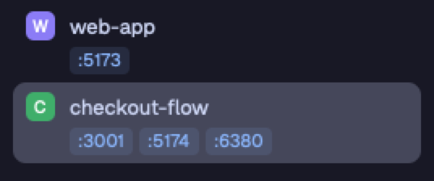

# Port Chips

Each space and each agent in the Herdr sidebar shows the TCP ports that its
programs listen on, as small chips such as `:5173`. Click a chip to open
`http://localhost:<port>` in the default browser. When you run the same app in
several git worktrees, you can open each one without a search for its port
number.



## What you see

- **Spaces list.** A space with live ports gets a second line under its name.
  The line holds one chip per port, lowest port first. The chips start under
  the space name: 27 px in for a top-level space (18 px avatar + 9 px gap),
  44 px in for a worktree space under its repo (22 px indent + 13 px branch
  icon + 9 px gap). A row with chips is at least 30 px tall (28 px for a
  worktree row), with 5 px of padding at the top and bottom. A row without
  chips is the same as in Herdr's own Spaces list.
- **Agents list.** An agent with live ports gets the same chip line under its
  row, 25 px in from the row's 8 px side padding, with 4 px below it. A
  sub-agent's chips start 31 px + 13 px per tree level + 22 px in.
- **A chip** is 17 px tall, with 5 px of padding at the sides, 4 px corners and
  11 px text that reads `:<port>`. Chips have a 4 px gap and wrap to a new line.
  - Web port: the theme's `accent` color for the text, on `accent` at 12%
    alpha (`accent + "1f"`).
  - Other port (a database, a debugger): `muted` text on `raised`.
- A line shows at most 6 chips. More ports show as `+<n>` in `dim` text.
- The tooltip reads `<process name> · open http://localhost:<port>`, or
  `<process name> · copy localhost:<port>` for a port that is not a web port.
- The narrow sidebar rail (narrower than 160 px) shows no chips.

## How it behaves

- **Agent status has no effect.** Working, blocked, done and idle agents all
  show their ports the same way. The status icons and sections are the same
  as in Herdr's Agents list.
- **Scan:** every 3 s while the window is in front, every 15 s while it is
  behind. Only one scan runs at a time. A new server shows within about 3 s,
  and a stopped one goes within about 3 s.
- **Which space and agent get a port:** the scan finds the parent processes
  of each listening process. The nearest one that is a live Herdr terminal
  gets the port, and so does that terminal's space (its `herdr.space` label).
  A dev server that you or an agent starts in a pane, or in an agent's
  background shell, shows under that agent and its space.
- **Listeners with no Herdr terminal as a parent** (nohup, a daemon): the scan
  reads the process's working folder. When it is inside the live folder of a
  local space's pane, that space gets the port (the longest folder wins). The
  scan skips a process whose working folder is `/` or the home folder. It also
  skips any space folder that is the home folder, so a space at `~` does not
  claim every stray process.
- **Click on a web port:** opens `http://localhost:<port>` with `open`.
- **Click on another port:** copies `localhost:<port>` to the clipboard and
  shows a toast, "Copied localhost:<port>", for 2 s.
- **A port is not a web port** when its number is 5432, 6379, 3306, 27017,
  11211, 9229, 9230, 5672, 4369, 2181 or 9092. It is also not a web port when
  its process name starts with postgres, redis, mysqld, mariadbd, mongod,
  memcached, beam, epmd, rabbitmq, nats, clickhouse or etcd (any case).
- A click on a chip does not select, drag or focus the row under it.
- Everything else (click to select, drag to reorder, right-click menu, agent
  pins, sorting, folding) is the same as in Herdr's own lists.

## Built from

- **Two mods**, each a `mod.clone` of a shipped mod plus the port code:
  - `mods/spaces-ports/`: a copy of `spaces`. It also runs the scan.
    - `ports.js`: `scan()` and `same()`.
    - `chips.js`: `portChips(t, key, ports, indent)`.
    - `main.js`: `spaces/main.js` with 3 changes:
      1. `init` starts the scan and a 1 s `cx.timer.every`, which scans
         when 3 s (front) or 15 s (behind, `window().active`) have passed.
      2. `scanPorts(cx)` runs `scan()` in `cx.spawn`. It calls
         `setShared("ports", result)` only when `same()` says the ports
         changed, so the other mods do not redraw for nothing.
      3. `row()` reads `shared("ports").bySpace[space.id]`, sets
         `min_h` and `py(5)` in place of the fixed height when there are
         chips, and adds the chip line as the row's last child.
  - `mods/agents-ports/`: a copy of `agents`. It does not scan.
    - `chips.js`: the same file as in `spaces-ports`.
    - `main.js`: `agents/main.js` with one change. `withKids` puts a chip
      line after each agent row and each sub-agent row, from
      `shared("ports").byTerminal[address]`. `mod.clone` already changed its
      sort popup's `openOverlay({ mod })` to `agents-ports`.
- **Shared state:** `shared("ports")` =
  `{ at, byTerminal: { <address>: Port[] }, bySpace: { <space id>: Port[] } }`,
  where `Port = { port, name, http }`, sorted by port. Each port is listed once
  per terminal and per space, even when a process listens on IPv4 and IPv6.
- **The scan** (`exec`, local only, 8 s timeout each):
  1. `lsof -nP -iTCP -sTCP:LISTEN -Fpcn`: pid, command name and `host:port`
     per listener. The port is the text after the last `:`.
  2. `ps -axo pid=,ppid=`: the parent of each process.
  3. `terminals()`: live terminals with a `pid` and an address without `/`
     (a `/` means another machine).
  4. Find the parents of each listener, up to 64 levels, until one is a
     terminal's `pid`.
  5. For the listeners with no terminal parent:
     `lsof -a -p <pids> -d cwd -Fpn` gives each working folder, which goes
     against the `cwd` of `panes()` for each local space's tabs.
- **Herdr functions:** `exec`, `terminals`, `spaces`, `panes`, `home`,
  `shared`, `setShared`, `window`, `theme`, `notify`. `h_flex` comes from
  `gpui-base`; `div` from `gpui-kit`.
- **Programs:** `lsof`, `ps`, `open`, `sh` and `pbcopy` (macOS).
- **To use it:** the layout's `spaces` block must show `spaces-ports`, and its
  `agents` block must show `agents-ports`. Shipped layouts are read-only, so
  clone one and change the two blocks' `content.mod`:

  ```sh
  herdr-app do layout.clone '{"name":"main","as":"herdr-ports"}'
  # then in layouts/herdr-ports.json:
  #   the node with id "spaces": "content": { "mod": "spaces-ports" }
  #   the node with id "agents": "content": { "mod": "agents-ports" }
  ```

- **No keys.** The mod adds no shortcuts and needs no `keys.json`.

## Watch out

- **The clones do not update.** Herdr replaces its own `spaces` and `agents`
  on every start, but never a clone. To get a newer Herdr list, clone it again
  and add the 3 changes in `spaces-ports/main.js` and the 1 change in
  `agents-ports/main.js` back. The port code is in `ports.js` and `chips.js`,
  so the work is small.
- **The two `chips.js` files must stay the same.** A mod can only import files
  from its own folder, so each mod has a copy.
- **`spaces-ports` must be in the layout** for the scan to run.
  `agents-ports` only reads `shared("ports")`. Without `spaces-ports`, its
  chips stay as they were at the last scan.
- **The rows under a chip act on press and release.** The spaces row starts
  a drag on mouse down and selects on mouse up. So the chip calls
  `cx.stop_propagation()` on `on_mouse_down("left")`, `on_mouse_up("left")`
  and `on_click`. Without this, a click on a chip also selects the space.
- **`h_flex` is not in `gpui-kit`.** Import it from `gpui-base`, or the mod
  fails to load.
- **This computer only.** The scan uses `lsof` and `ps` here and skips
  terminals on other machines. Links always go to `localhost`.
- **macOS only as written:** `open` and `pbcopy`. On Linux, use `xdg-open`
  and `wl-copy` or `xclip`.
- **Only Herdr terminals count.** A server that a different terminal app
  started (or an older Herdr server) shows only when its working folder is
  inside a space's folder.
- **Some listeners are not yours to open:** a process that listens on a port
  is not always a web server. The not-a-web-port lists cover the common
  databases; anything else opens in the browser.
- `lsof` without root sees only your own processes. That is correct here.

## Done when

1. `herdr-app check mods/spaces-ports` and `herdr-app check mods/agents-ports`
   both pass.
2. With the layout switched to the clone (`herdr-app do layout.switch
   --name herdr-ports`), `herdr-app status` shows `"errors": []`.
3. In a new space, `python3 -m http.server 5173 --bind 127.0.0.1` makes a
   `:5173` chip show under that space within about 3 s.
4. `shared.json` then has `ports.bySpace.<that space id>` =
   `[{ "port": 5173, "name": "Python", "http": true }]`.
5. In an agent's terminal, a server that the agent starts in a background
   shell shows its chip under the agent row too.
6. A click on `:5173` opens `http://localhost:5173`, and the selected space
   does not change.
7. A server on port 6379 shows a grey chip, and a click copies
   `localhost:6379`.
8. Stop the server, and the chip goes away within about 3 s.
9. Seven listening ports in one space show 6 chips and `+1`.
